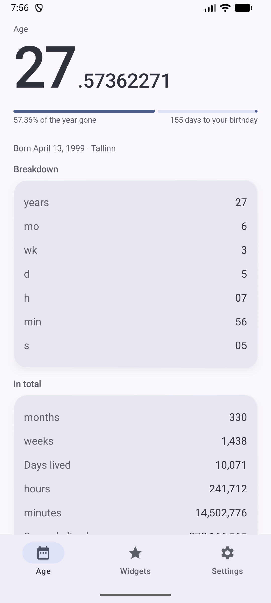
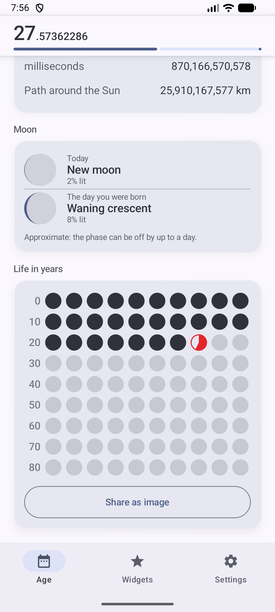
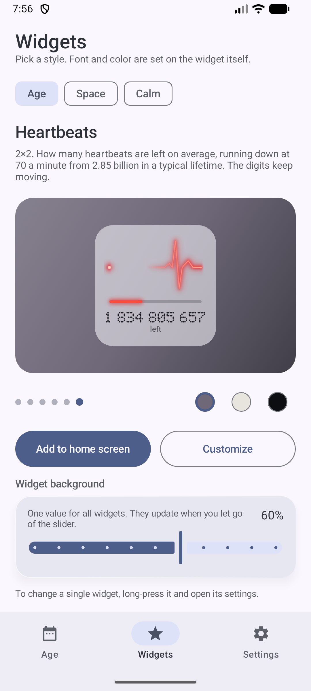
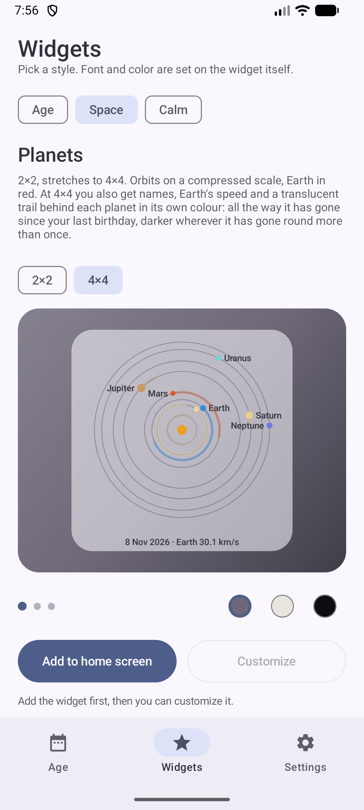
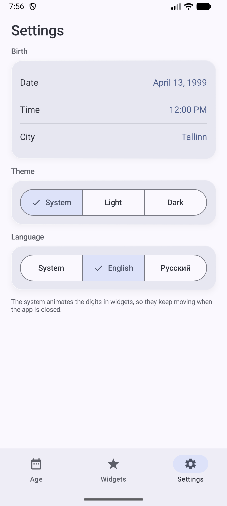

# Anicca

[](https://github.com/sonechkammr/anicca-cave/actions/workflows/ci.yml)

Android home-screen widgets about time passing. It started with your age as a number with eight decimals, moving in
real time, and grew into ten widgets and a small app around them.
*Anicca* is the Pali word for impermanence. The package id is still `com.lifeclock.widget`, so widgets already on a home
screen survive every update.

Kotlin, RemoteViews for the widgets, Jetpack Compose for the app. Colours follow Material You. English and Russian.

<p>
  
  
  
  
  
</p>

## The app

- **Setup:** one sentence, "I was born on [date] at [time] in [city]". Each part opens a sheet with the Material calendar,
  a clock dial, or a searchable city list, so a birth date can be set without the keyboard.
- **Today:** the age is a large header that folds into a compact bar while you scroll. Below it: a breakdown, totals,
  the path around the Sun, the moon now and on your birth day, and the life in years, which can be shared as an image.
- **Widgets:** a showcase with one big live preview at a time, category chips, Add to home screen, Customize, and a
  background slider.
- **Settings:** the same pickers, theme, and a per-app language on Android 13 and newer.

## Widgets

| Widget | Size | Shows |
|---|---|---|
| Age | 2×2 | the number only |
| Life in years | 2×2 | a circle per year of life, the current one filling up |
| Year ruler | 4×2 | the number and a tape with a tick per day |
| Year in days | 4×2 | the number and a dot per day |
| Path around the Sun | 2×2 | whole kilometres travelled with Earth since birth, grouped by thousands, running |
| Birth light | 2×2 | the light of your birth day as a ring among nearby stars, and which star it reaches next |
| Mala | 2×2 | 108 beads, one moves a day, finished laps in the middle |
| Heartbeats | 2×2 | how many beats are left on average (2.85 billion, about 77 years at 70 a minute), running down to the last digit, and one word: "left" or "ещё" |
| Stone garden | 4×2 | raked sand with stones and ripples that meet and cancel, a new arrangement every day from the date |
| Planets | 2×2 → 4×4 | the eight planets from above on a compressed scale; from about 4×4 also names, Earth's speed and, behind each planet, a translucent trail in its own colour for the way it has gone since your last birthday, darker where it has gone round more than once |

Digits are vector drawables, so there is no font dependency. The fast decimals are a ViewFlipper that Android runs by
itself; an inexact alarm builds the next set of frames. No background service.

Averages stay averages: heartbeats and similar are shown as "so far" or "on average", never as a forecast. Planet
positions come from the JPL Keplerian elements (valid 1800-2050), computed on the phone with no network; the moon phase
is the mean synodic month and can be off by up to a day.

## Download

- Every push builds the app in GitHub Actions; the **Anicca-debug-apk** artifact of a run is the debug APK (kept 14 days).
- `LifeClock-debug.apk` in this repository is a debug build too. It is signed with the debug key, needs Android 12 or
  newer, and replaces an older install only if that was signed the same way.

## Build

Android Studio's JDK (17 or newer) and SDK platform 37. Put the SDK path in `local.properties` as `sdk.dir=...`
(on Windows escape the drive colon and the backslashes). Build from a path that has only ASCII characters.

```
./gradlew assembleDebug testDebugUnitTest lintDebug
```

On Windows use `gradlew.bat`, and if your user name is not ASCII also set `GRADLE_USER_HOME` to an ASCII folder.
Lint fails the build on missing translations and hard-coded text.

## Project

```
app/src/main/java/com/lifeclock/widget/
  ui/            the Compose app: navigation, theme and tokens, today, widgets, settings
  widget/        providers, the renderer and the picture code for the widgets (RemoteViews)
  *.kt           the maths: age, pulse, planets, moon, trip, stars, garden
app/src/test/    59 unit tests
docs/screenshots the pictures above
```

Adding a widget: write its renderer, add a provider class and a `<receiver>` in the manifest, then add one entry to
`WidgetRegistry`. The Widgets tab, refresh and the picker previews pick it up from there. More notes, design rules and
pitfalls are in [`CLAUDE.md`](CLAUDE.md); what changed is in [`CHANGELOG.md`](CHANGELOG.md).

## RemoteViews gotcha

Widget layouts can only use classes that RemoteViews allows. A bare `<View>` in the layout makes the launcher drop the
preview and the widget show "Can't load widget". Use `FrameLayout` for spacers and dividers.
